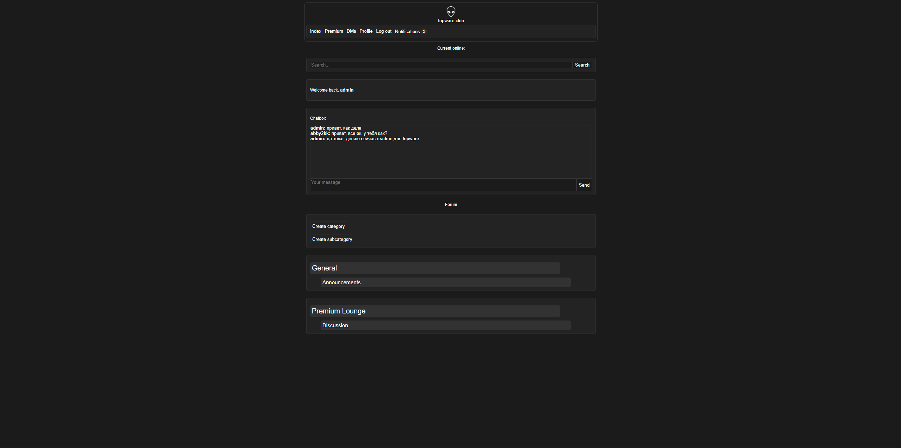

# Tripware
Форум на FastAPI с автоматической модерацией постов через LLM.
Демо: [https://](https://tripware.ru/)

## Возможности
- Регистрация и JWT-авторизация
- Посты, комментарии, профили
- Чат в реальном времени (WebSocket)
- Модерация и краткое содержание постов через LLM (фоновые задачи)

## Стек
Python, FastAPI, SQLAlchemy (async), Alembic, MySQL, Redis, Celery, Docker

## Архитектура
Слои: роутеры → сервисы → репозитории. Redis используется для
кеша, rate limit и pub/sub между воркерами. Вызовы LLM вынесены
в фоновые задачи; при недоступности API задача повторяется, затем
пост уходит на ручную модерацию.

## Запуск
1. `cp .env.example .env`
2. `docker compose up --build`
3. Приложение: http://localhost:8000, документация: /docs

## Тесты
`pytest`

## Планы
- Перенести все фоновые задачи в Celery
- Перейти на PostgreSQL
- Добавить CI
